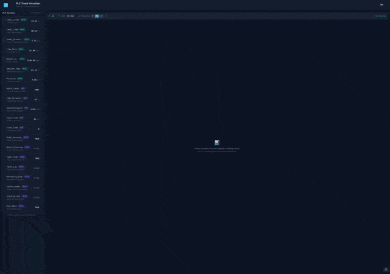
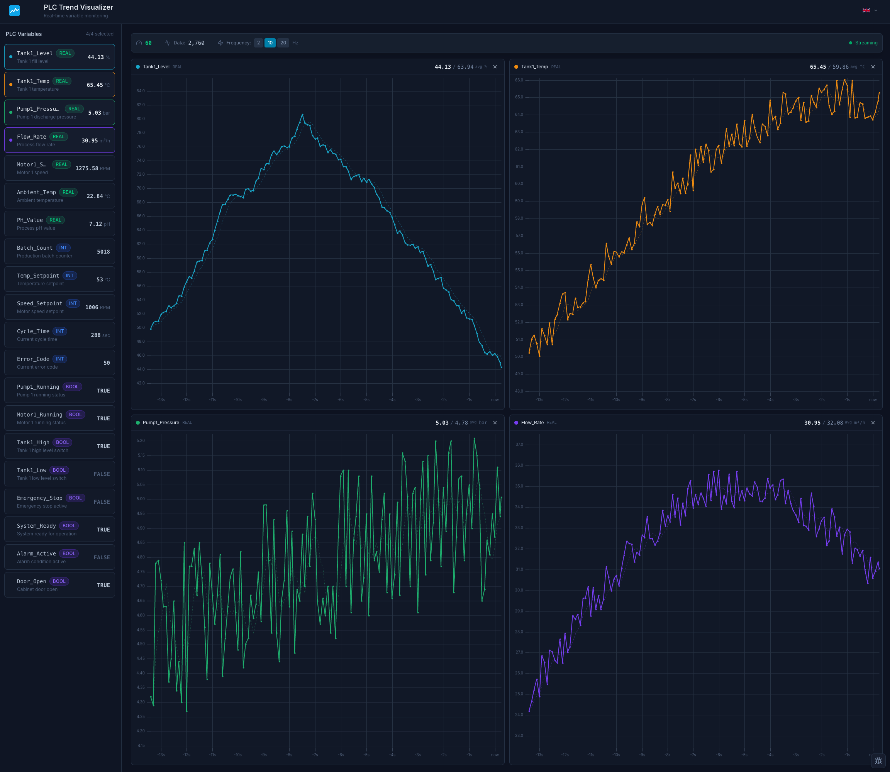
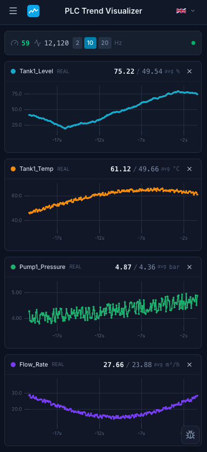

# PLC Variable Trend Visualizer

A real-time PLC variable trend visualization application built with Vue 3 and TypeScript. This project demonstrates senior-level frontend architecture for industrial automation interfaces, maintaining 60fps performance with high-frequency data streams.

[](https://vuejs.org/) [](https://www.typescriptlang.org/) [](https://tailwindcss.com/) [](https://vite.dev/)

## Demo



### Screenshots

<details>
<summary>Click to expand screenshots</summary>

#### Main Dashboard


#### Mobile View


</details>

## Features

- **Real-time Data Visualization**: Display up to 4 synchronized trend charts simultaneously
- **20 Mock PLC Variables**: BOOL, INT, and REAL data types with realistic patterns
- **Configurable Update Frequency**: 2Hz (low), 10Hz (medium), or 20Hz (high)
- **60fps Rendering**: Canvas-based charts with RAF-batched updates
- **Industrial UI Theme**: Professional dark theme with accessible colors
- **Internationalization (i18n)**: Multi-language support (English, Norwegian)
- **DevTools Overlay**: FPS monitoring and activity logging (dev mode only)

## Tech Stack

| Technology | Purpose |
|------------|---------|
| **Vue 3.5** | Composition API with `<script setup lang="ts">` |
| **TypeScript** | Strict mode type safety |
| **Vite 7** | Fast development and optimized builds |
| **uPlot** | High-performance Canvas-based charting |
| **RxJS** | Data stream processing with backpressure |
| **vue-i18n** | Internationalization with type-safe translations |
| **Tailwind CSS 4** | Utility-first styling |
| **CVA** | Type-safe component variants |
| **Histoire** | Component documentation |
| **Vitest** | Unit and component testing |
| **Playwright** | E2E testing |

## Quick Start

### Prerequisites

- Node.js 20+
- npm

### Installation

```bash
# Install dependencies
npm install

# Start development server
npm run dev
```

Visit `http://localhost:5173` to view the application.

### Available Scripts

```bash
# Development
npm run dev          # Start dev server
npm run build        # Build for production
npm run preview      # Preview production build

# Testing
npm test             # Run tests in watch mode
npm run test:run     # Run tests once
npm run test:e2e     # Run Playwright E2E tests

# Component Documentation
npm run story:dev    # Start Histoire dev server
npm run story:build  # Build static documentation

# Code Quality
npm run lint         # Run ESLint
npm run lint:fix     # Fix ESLint issues
npm run format       # Format with Prettier
npm run type-check   # TypeScript type checking
```

## Architecture

### Folder Structure

```
src/
├── core/                    # Framework-agnostic TypeScript
│   ├── types/               # Type definitions
│   ├── chart/               # RingBuffer for data history
│   ├── data/                # PLC simulator and data pipeline
│   └── devtools/            # FPS monitor and analytics
├── components/
│   ├── ui/                  # Design system primitives
│   ├── charts/              # Domain-specific chart components
│   ├── layout/              # Header, Sidebar
│   └── devtools/            # DevTools overlay
├── composables/             # Vue composables
├── i18n/                    # Internationalization (vue-i18n)
│   └── locales/             # Translation files (en, no)
├── lib/                     # Utilities (cn helper)
└── styles/                  # CSS tokens and base styles
```

### Key Design Decisions

#### 1. Canvas-based Charts (uPlot)

**Why**: SVG-based charts (Chart.js, Recharts) become sluggish with frequent updates. uPlot renders directly to Canvas, achieving 60fps even with 20Hz data streams.

**Trade-off**: Less styling flexibility, but performance is critical for real-time data.

#### 2. RxJS for Data Streams

**Why**: Native browser events lack backpressure handling. RxJS provides:
- `sampleTime(16)` — Throttles to ~60fps
- `share()` — Multicasts to multiple chart subscribers
- `takeUntil(destroy$)` — Automatic cleanup on component unmount

**Limited Operators**: Only 6 operators used (Subject, share, sampleTime, map, filter, takeUntil) to keep bundle size small.

#### 3. shallowRef for Chart Data

**Why**: Vue's deep reactivity adds overhead for arrays that update frequently. Using `shallowRef` with `triggerRef()` bypasses unnecessary proxy wrapping.

```typescript
const history = shallowRef<DataPoint[]>([])

// Update without deep reactivity overhead
ringBuffer.push(newPoint)
history.value = ringBuffer.toArray()
triggerRef(history)
```

#### 4. Ring Buffer for History

**Why**: Standard arrays require expensive `.shift()` operations for fixed-size histories. The RingBuffer provides O(1) insertion with automatic eviction.

#### 5. Framework-Agnostic Core

**Why**: The `/src/core/` layer has zero Vue imports, making it:
- Unit testable without component mounting
- Portable to other frameworks if needed
- Clearly separated from UI concerns

### Performance Optimizations

1. **RAF-batched Chart Updates**: `requestAnimationFrame` coalesces rapid data updates
2. **markRaw() for Chart Instances**: Prevents Vue from making uPlot reactive
3. **Cursor Sync via uPlot**: Native sync key, no Vue watchers needed
4. **CSS Containment**: Applied to chart containers for layout isolation

## Component Catalog

Run Histoire to explore the component library:

```bash
npm run story:dev
```

Components documented:
- `Button` — Primary, secondary, ghost, danger variants
- `Card` — Container with elevation variants
- `Badge` — Status indicators and data type labels
- `Toggle` — Accessible switch component
- `Toast` — Notification system with info, success, warning, error variants

## Internationalization (i18n)

The application supports multiple languages using vue-i18n. Currently available: **English** (default) and **Norwegian**.

Translation files are located in `src/i18n/locales/`.

## Testing

### Unit Tests

```bash
npm test
```

Tests cover:
- `RingBuffer` — Circular buffer implementation
- `PlcSimulator` — Data generation
- `FpsMonitor` — Performance tracking

### E2E Tests

```bash
npm run test:e2e
```

## DevTools

In development mode, a DevTools overlay is available in the bottom-right corner:

- **FPS Monitor**: Real-time frame rate display
- **Activity Log**: Tracks user actions and system events
- **Export**: Download activity log as JSON

## PLC Variables

The simulator provides 20 mock variables:

| Category | Variables | Description |
|----------|-----------|-------------|
| **REAL** | Tank levels, temperatures, pressure, flow rate, motor speed, pH | Analog measurements with various patterns |
| **INT** | Batch count, setpoints, cycle time, error codes | Counters and discrete values |
| **BOOL** | Pump status, motor status, level switches, alarms, door sensors | Digital I/O states |

## Stretch Goals (Future)

- [ ] Persistent chart configurations (localStorage)
- [ ] Variable search/filter
- [ ] CSV export of trend data
- [ ] Custom time range selection
- [ ] Alarm threshold visualization
- [ ] WebSocket integration for real PLC data
- [ ] Move UI components to seperate repository
- [ ] Additional language translations (German, Swedish, etc.)

## Known Limitations & Trade-offs

| Decision | Trade-off |
|----------|-----------|
| **Time-based X-axis (20s window)** | Assignment mentioned "50 data points" but a fixed time window is more intuitive for operators. At 20Hz this shows 400 points; at 2Hz only 40 points. |
| **uPlot over Chart.js/Recharts** | Less ecosystem support and styling flexibility, but ~10x better performance for real-time data |
| **No persistence** | Chart selections reset on refresh. Could add localStorage but kept scope minimal |
| **Separate charts per variable** | Could overlay all on one chart, but separate Y-axes are clearer for variables with different units/ranges |
| **Mock data only** | No WebSocket/real PLC integration. Would need protocol adapters (OPC-UA, Modbus) for production |

## Performance Metrics

Target: **60fps** with 20Hz data streams and 4 active charts

Measured on MacBook Pro M2 (Chrome 142, 4 charts @ 20Hz, 10-second recording):

| Metric | Value |
|--------|-------|
| **Frame Rate** | 60fps (vsync-locked via RAF) |
| **CPU Usage** | 15-25% |
| **JS Heap** | ~83MB |
| **Scripting** | 895ms (9.7%) |
| **Rendering** | 147ms (1.6%) |
| **Painting** | 160ms (1.7%) |

The low rendering/painting times confirm that uPlot's Canvas-based approach keeps GPU work minimal, while the majority of work is JavaScript (data processing, Vue reactivity).

## License

MIT
